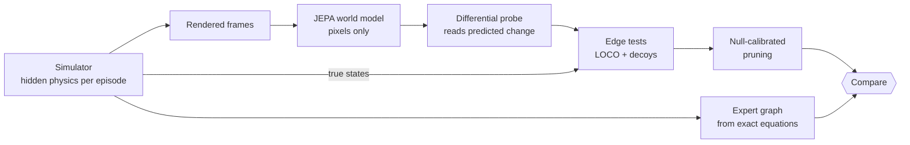
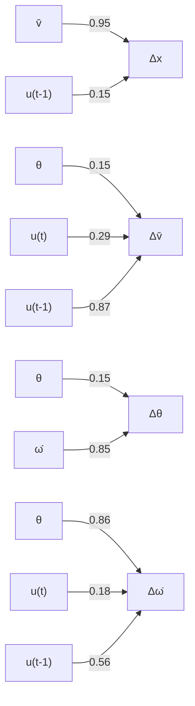
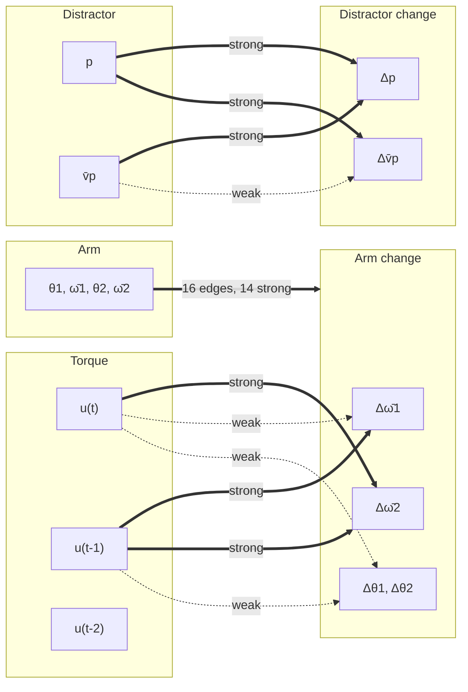
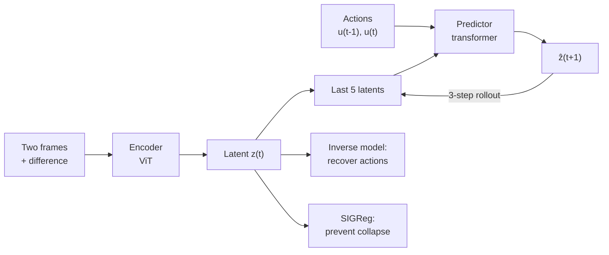
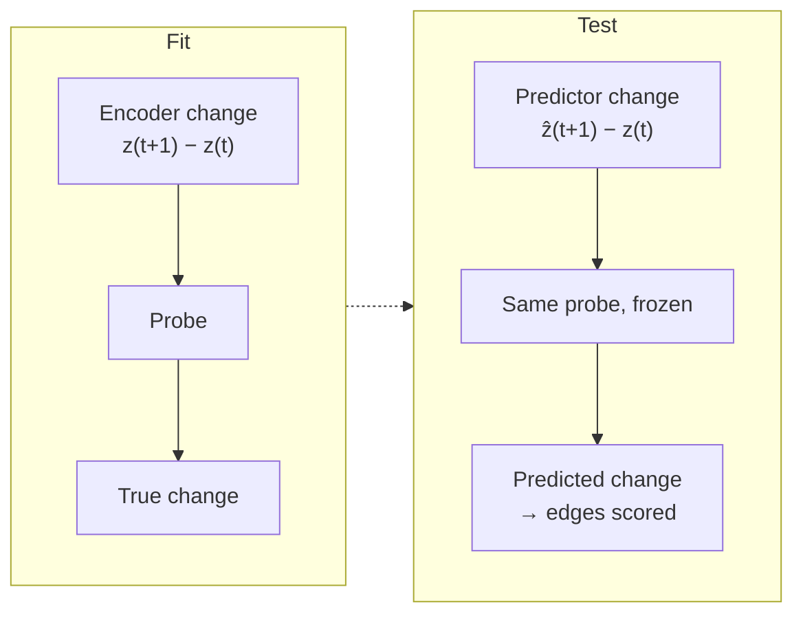
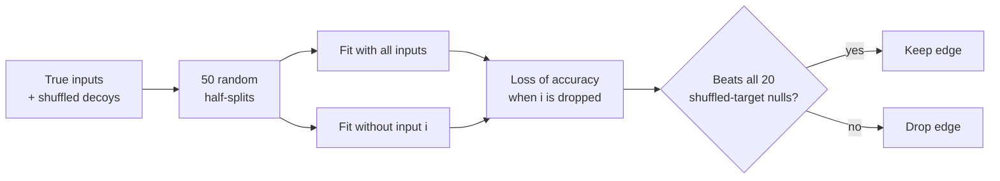
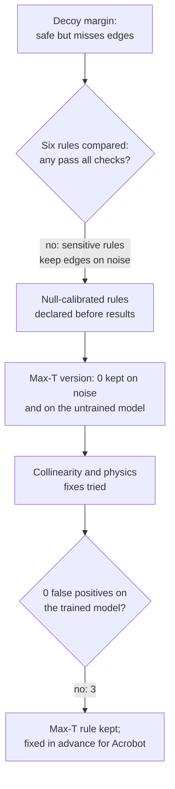
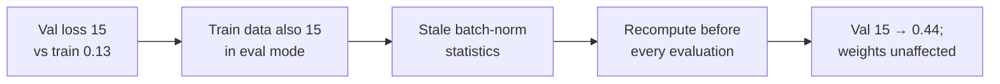
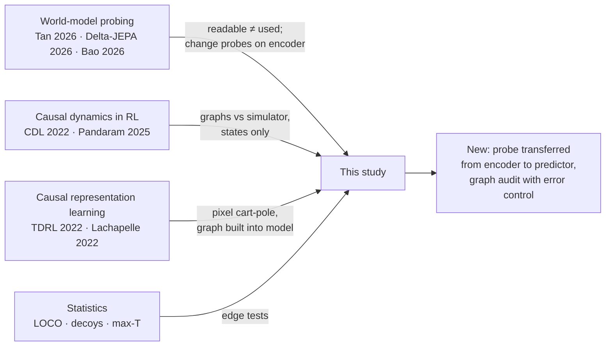
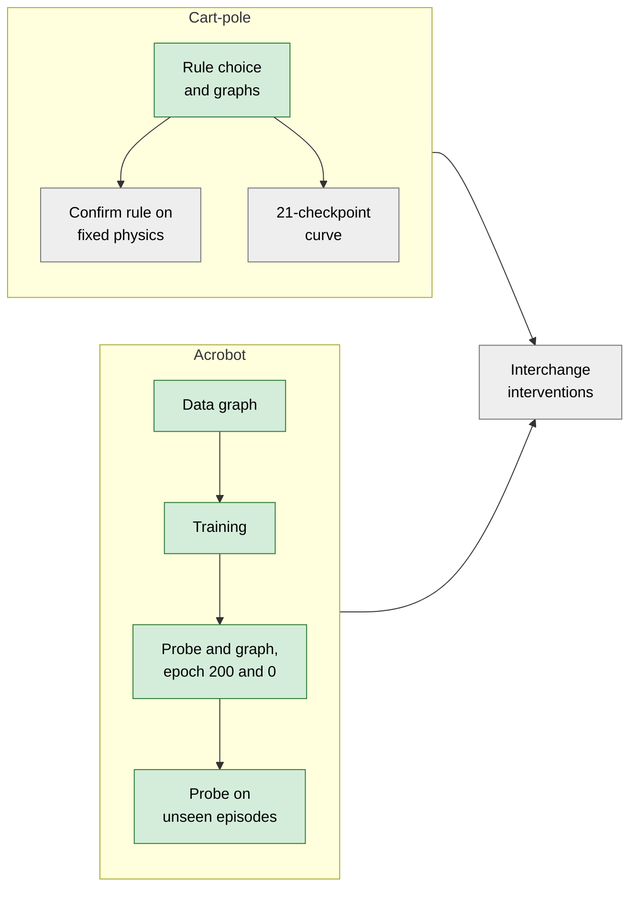

# Do JEPA world models learn causal structure?

Cart-pole and Acrobot · BTP report · 2026-11-12 · Code, run order and file locations: [README.md](README.md)

## At a glance

| | Cart-pole | Acrobot |
|---|---|---|
| Candidate edges | 28 (10 strong, 7 weak, 11 absent) | 54 (20 strong, 8 weak, 26 absent) |
| Equation checks | 6 / 6 pass | 6 / 6 pass |
| Graph from true data (F1 · kept · false positives) | 0.84 · 10 · 1 | 0.97 · 19 · 0 |
| Graph from trained model | 0.75 · 6 · 0 | 1.00 · 17 · 0 on the four readable targets; 10 false positives into the two unreadable ones |
| Graph from untrained model | 0 kept | 4 kept, 2 false positives |

- **Cart-pole:** the trained model's graph keeps only true edges. It misses the pole-angle edges, which the method cannot separate.
- **Acrobot:** on the four targets the probe can read, the trained model's graph matches the expert graph exactly. The model ignores the distractor, which leaves 10 false positives into unreadable targets. It memorizes its training episodes, but the graph is nearly the same on unseen episodes.
- **Prior work:** no published study audits a pixels-only world model's causal graph this way. The closest papers are 2026 preprints that each share part of the method.

## 1. Approach

Two rules hold throughout:
- **Edge inputs are true simulator states,** so a missing edge reflects the model's prediction, not a bad input reading.
- **Thresholds are fixed before results.** The pruning rule is chosen on graphs that do not depend on the model's quality.

## 2. Environments

| | Cart-pole | Acrobot |
|---|---|---|
| Dynamics | Frictionless cart-pole, Euler step 0.02 s | Double pendulum (Spong), Euler step 0.01 s |
| One transition | 0.04 s | 0.04 s |
| Action | Force, ±10 N | Elbow torque, ±3 N·m |
| Hidden physics per episode | Cart mass, pole mass, pole length, gravity | Both link masses, both lengths, gravity |
| Extra object | None | Distractor: independent spring-driven block, giving 22 truly absent edges |
| Variables | x, θ, frame-averaged v̄, ω̄ | θ1, θ2, ω̄1, ω̄2, distractor p, v̄p |
| Episodes / usable transitions | 1900 / 33,040 | 1900 / 62,990 |

Episode mix (both environments): 900 random-action, 500 square-wave (PRBS), 250 passive, and 250 task-specific (cart-pole: LQR from wide angles; Acrobot: energy-pumping swing-up). Frames are 128×128 and anti-aliased.

## 3. Answer key

| Check | Cart-pole | Acrobot |
|---|---|---|
| Equations match Lagrangian | 2e-14 | 1e-15 |
| Energy conserved (no action) | drift 6e-5 | drift 1e-4 |
| Velocities observable from two frames + previous action | R² 0.996 | R² ≈ 1 |
| Jacobian zeros match the hand-derived graph | yes | yes, all 22 cross edges zero |
| Strong / weak / absent (cut 0.1) | 10 / 7 / 11 | 20 / 8 / 26 |
| History gain when physics is hidden | 0.090 | 0.098 |

### Cart-pole strong edges

### Acrobot graph

No edges from u(t−2), and none between the arm and the distractor.

## 4. World model

Same model and settings for both environments: 200 epochs, 21 checkpoints, pixels only.

| Run | Train / val loss | Val rollout error |
|---|---|---|
| Cart-pole, fixed physics | 0.021 / 0.109 | 0.0031 |
| Cart-pole, varied physics | 0.024 / 0.138 | 0.0072 |
| Acrobot | 0.025 / 0.450 | 0.023 |

## 5. Reading the model: the differential probe

An untrained encoder already decodes pole angle with R² ≈ 0.95, so reading the *state* proves nothing. We read the *predicted change*.

The probe never sees predictor output while fitting. It reads the predictor correctly only if the predictor moves the latent the way real dynamics do. A target is testable only if the encoder's own change is readable (R² ≥ 0.5).

## 6. Scoring and pruning edges

Eight pruning rules were compared on cart-pole. Each cell is F1 · edges kept · false positives:

| Rule | True data | Noise-matched data | Pure noise (want 0) | Untrained model (want 0) | Trained model |
|---|---|---|---|---|---|
| Decoy margin | .75 · 9 · 0 | .46 · 3 · 0 | 0 | 0 | .57 · 4 · 0 |
| FDR | .65 · 26 · 11 | .74 · 23 · 7 | 11 | 0 | .69 · 19 · 7 |
| Minimum effect | .84 · 10 · 1 | .84 · 10 · 1 | 7 | 0 | .75 · 7 · 0 |
| Jacobian effect | .78 · 15 · 4 | .75 · 16 · 5 | 16 | 28 | .77 · 19 · 6 |
| Effect + FDR | .78 · 14 · 4 | .75 · 15 · 5 | 11 | 0 | .72 · 17 · 6 |
| Knockoffs | .74 · 12 · 2 | 0 kept | 0 | 0 | 0 kept |
| Null-calibrated, per edge | .84 · 10 · 1 | .84 · 10 · 1 | 3 | 0 | .75 · 7 · 0 |
| **Null-calibrated, max-T (chosen)** | **.84 · 10 · 1** | **.84 · 10 · 1** | **0** | **0** | **.75 · 6 · 0** |

## 7. Results: cart-pole

| Model | Δx | Δv̄ | Δθ | Δω̄ |
|---|---|---|---|---|
| Trained on fixed physics, tested on fixed | 0.95 | 0.98 | 0.87 | 0.91 |
| Trained on fixed physics, tested on varied | 0.90 | 0.65 | 0.79 | 0.66 |
| Trained on varied physics | 0.85 | 0.94 | 0.90 | 0.86 |

Predictor-change R². The untrained model scores strongly negative.

| Graph | Kept | Missed strong | False positives |
|---|---|---|---|
| True data | 10 | θ→Δv̄, θ→Δθ | v̄→Δω̄ |
| Trained model | 6: v̄→Δx and all five strong action edges | θ→Δv̄, θ→Δθ, θ→Δω̄, ω̄→Δθ | none |
| Untrained model | 0 | all | none |

- **Pole edges are missed because of collinearity.** θ and ω̄ are 95% predictable from the other inputs, and a leave-one-out test measures only unique information.
- **The data's false positive comes from hidden physics.** Telling the fit each episode's physics removes it (effect 0.43 → 0.04).
- **The model uses its history to infer physics.** Its Δv̄ (0.94) beats the 0.89 ceiling for a model without history.

## 8. Results: Acrobot

**True data graph:** strong-graph F1 0.97, no false positives, none of the 22 cross edges kept. It missed one strong edge and all 8 weak edges.

**Batch-norm problem, found and fixed during training:**

**Probe, change R²:**

| Target | Trained: encoder | Trained: predictor | Testable | Untrained: encoder | Untrained: predictor |
|---|---|---|---|---|---|
| Δθ1 | 0.88 | 0.90 | yes | 0.25 | −3.4 |
| Δω̄1 | 0.77 | 0.79 | yes | 0.00 | −2.1 |
| Δθ2 | 0.68 | 0.72 | yes | 0.06 | −2.3 |
| Δω̄2 | 0.76 | 0.79 | yes | 0.01 | −2.3 |
| Δp (distractor) | −0.03 | −0.02 | no | 0.75 | −5.4 |
| Δv̄p (distractor) | −0.03 | −0.02 | no | −0.06 | −1.2 |

- **The distractor is not encoded.** Nothing in the training loss rewards it, so 14 of the 22 cross edges cannot be tested.
- **The model memorizes.** At epoch 150, torque recovery is R² 0.99 on training episodes and −0.38 on new ones (cart-pole: about 0.8), and the first-step rollout error on new episodes is 5.5× training. At epoch 200 the logged rollout loss is 0.023 on validation and 0.0054 in training.

### Graph from the trained model (50 splits, max-T rule)

| | Trained (epoch 200) | Untrained (epoch 0) |
|---|---|---|
| Readable targets only: F1 · false positives · missed | **1.00 · 0 · 0** (17 strong, 12 absent edges, all correct) | 0.00 · 2 · 2 (only Δp readable) |
| All 54 edges: strong F1 · kept · false positives | 0.72 · 29 · 10 | 0.17 · 4 · 2 |
| Strong-graph AUROC | 0.83 | 0.52 |
| Weak edges recovered | 2 / 8 | 0 / 8 |
| Distractor → arm edges kept (0 expected) | 0 / 8 | 0 / 8 |

- **The arm graph is recovered exactly,** including every angle edge. The encoder's own graph is identical on these targets, and the two agree closely overall (Spearman 0.99).
- **The 10 false positives are all arm or torque → Δp / Δv̄p.** Those targets cannot be read (R² −0.03), so the probe's output for them is noise that varies with the arm. These edges say nothing about what the model believes, and the pruning rule does not screen them out.
- **The untrained predictor's floor is not empty.** It keeps θ1→Δθ1 and ω̄1→Δθ1 (both true) and θ1→Δp and ω̄1→Δp (both false). Cart-pole's floor kept nothing.
- **Training discarded the distractor.** The untrained encoder reads Δp at R² 0.75; the trained one reads −0.03.
- **Torque effects:** the model also responds to u(t−2) (effect 0.05–0.08), where the truth is exactly zero. No u(t−2) edge was kept.

### Same graph on unseen episodes (validation split)

190 episodes the model never trained on (6,310 rows, 8× fewer than training). The probe, the null and the scoring were all redone at this size. The true-label graph at this size is perfect (F1 1.00), so the sample is large enough.

| Predictor graph | Training episodes | Unseen episodes |
|---|---|---|
| All 54 edges: strong F1 | 0.72 | 0.74 |
| Strong-graph AUROC | 0.83 | 0.84 |
| Kept · false positives · missed | 29 · 10 · 3 | 26 · 7 · 4 |
| Readable targets only: F1 · false positives · missed | 1.00 · 0 · 0 (4 targets) | 0.97 · 0 · 1 (3 targets) |
| Probe R² on Δθ1 · Δω̄1 · Δθ2 · Δω̄2 | 0.90 · 0.79 · 0.72 · 0.79 | 0.79 · 0.56 · 0.51 · 0.60 |

- **The graph holds on unseen episodes.** Overall quality is unchanged, and no distractor → arm edge is kept.
- **Readable-target result:** no false positives. The one miss is the borderline strong edge u(t) → Δω̄2 (normalised effect 0.118).
- **Only three targets count as readable here.** Δθ2 falls just under the R² 0.5 cut for the encoder (0.49), so the two columns are not on identical targets.
- **The read-out is weaker on unseen episodes** (R² down by 0.1–0.2). The probe was refitted on only about a fifth as many rows, so this mixes model generalization with probe sample size.
- **The distractor edges remain wrong:** 7 false positives into Δp / Δv̄p, and the block's own edges (p → Δp, p → Δv̄p, v̄p → Δp) are missed.

## 9. Related work

### Closest work

| Paper | Shares | Lacks |
|---|---|---|
| Tan et al. 2026, PokeWorld (preprint) | JEPA + SIGReg, hidden physics, untrained reference; "readability does not guarantee correct use" | Transferred probe, graph, error control |
| Delta-JEPA 2026 (preprint) | Same architecture; encoder change → state change probe | Probe on the predictor; untrained control |
| Bao 2026 (preprint) | Random Dreamers decode energy, so test the transition instead | Graph; actions |
| Gonzalez Laiz & Schneider 2026 (preprint) | Cart-pole from pixels; finds latent dynamics unfaithful | Graph; untrained control |
| Pandaram et al. 2025 (preprint) | Ground truth from simulator Jacobians, cart-pole included | Pixels |
| TDRL 2022, Lachapelle et al. 2022, CDL 2022 | Hidden-gravity pixel cart-pole; learned action and state graphs | Testing an ordinary trained model |

### What is new and what is not

| New | Not new |
|---|---|
| Probe fitted on encoder changes, frozen, applied to predictor changes | Every statistical test (LOCO, decoys, max-T, exact p-values) |
| Edge-level graph from a pixels-only world model, scored against exact equations | "A random network already decodes the state" |
| False-positive control with an untrained-predictor floor and known-absent distractor edges | Encoder-side change probes (Delta-JEPA) |

The gap is real but narrow: a pre-registered combination of known tests, with one new step.

## 10. Limitations and fixes

| Limitation | Fix |
|---|---|
| The 5% per-graph guarantee holds only when no edge is real | Residual permutation, or a test with planted correlated null inputs |
| 20 null repeats give a smallest p of 0.048 | 99 or more repeats |
| Shuffling rows across autocorrelated time steps | Shuffle whole episodes |
| Shuffled decoys don't mimic correlated null inputs | Conditional or knockoff decoys |
| θ and ω̄ not separately identifiable | Test them as one group; report as "not separable" |
| Expert graph assumes known physics; model and data average over it | Use model-vs-data agreement as the main comparison |
| Edges show dependence, not causal use | Interchange interventions using simulator counterfactual frames |
| One training seed per environment | 3 or more seeds |
| Acrobot read-out weaker on unseen episodes (probe refit on fewer rows) | Train the probe on training episodes and apply it to unseen ones |
| One-step readout only | Apply the probe to multi-step rollouts |
| Weak edges out of reach | Judge on the strong graph only |

## 11. Next steps

Green = done, grey = to do. The Acrobot training curve is postponed.

## References

*Preprint* = not peer reviewed when checked. Verify all entries before citing.

**Closest work**
- Tan et al. 2026, What Can Latent World Models Know? arXiv 2607.27017 (preprint)
- Zhang, Wang et al. 2026, Delta-JEPA. arXiv 2606.31232 (preprint)
- Bao 2026, Correcting a learned physical invariant improves world-model rollouts. arXiv 2608.23526 (preprint)
- Gonzalez Laiz & Schneider 2026, Understanding the Limits of Latent World Models. arXiv 2610.37588 (preprint)
- Pandaram et al. 2025, Dynamic Sparsity. arXiv 2511.08086 (preprint)

**World models and probing**
- LeWorldModel. arXiv 2603.19312 (preprint); LeJEPA / SIGReg. arXiv 2511.08544 (preprint)
- Joseph et al., Interpreting Physics in Video World Models. ICML 2026
- Garrido et al. 2025, Intuitive physics from self-supervised video. arXiv 2502.11831
- Vafa et al., What Has a Foundation Model Found? ICML 2025
- Li et al., Othello-GPT. ICLR 2023
- Hewitt & Liang, control tasks. EMNLP 2019; Zhang & Bowman 2018

**Causality**
- Richens & Everitt, Robust Agents Learn Causal World Models. ICLR 2024
- Wang et al., CDL. ICML 2022; Seitzer et al., CAI. NeurIPS 2021
- Yao et al., TDRL. NeurIPS 2022; Lachapelle et al. CLeaR 2022 / JMLR 2026
- Geiger et al., Causal Abstraction. JMLR 2025; Sutter et al. NeurIPS 2025

**Statistics**
- Lei et al., LOCO. JASA 2018; Verdinelli & Wasserman. JMLR 2024
- Westfall & Young 1993; Phipson & Smyth 2010; Winkler et al. 2014
- Barber & Candès 2015; Candès et al. 2018
